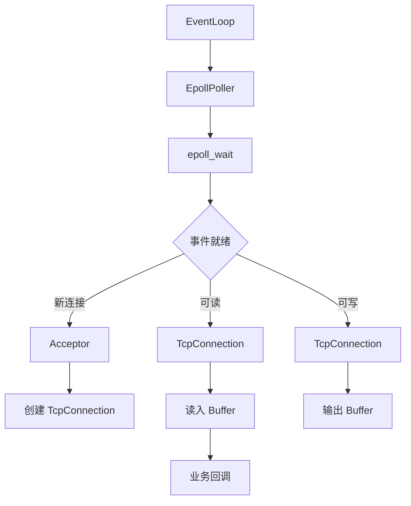

# cpp-reactor-server

一个从零实现的 C++17 Linux epoll Reactor 高并发网络服务器，用于学习 C++ 后端 / 游戏服务器开发。

> 项目驱动学习，拒绝只输入不输出。  
> 每天一个 GitHub commit，用输出倒逼输入。

---

## 项目目标

- 从零实现基于 `epoll` 的 Reactor 网络服务器
- 掌握非阻塞 IO、IO 多路复用、线程池、定时器、心跳机制
- 解决 TCP 粘包/拆包，实现自定义长度协议
- 最终演进为“基于 Reactor 的高并发多人游戏服务器”
- 为 2027 年暑期实习和开源之夏（OSPP）积累硬核项目经历

---

## 当前进度

> 更新时间：2026-10-14

- [ ] 阻塞 TCP echo server
- [ ] 非阻塞 + epoll LT echo server
- [ ] 单线程 Reactor 重构
- [ ] 多线程 Reactor + 线程池
- [ ] 定时器 / 心跳机制
- [ ] 4 字节长度前缀协议（解决粘包/拆包）
- [ ] 压测与性能瓶颈分析
- [ ] 游戏业务层：登录、匹配、AOI、状态同步
- [ ] 存储层：Redis 排行榜、MySQL 持久化

---

## 技术栈

- 语言：C++17
- 构建：CMake
- 平台：Ubuntu / WSL2
- 网络：Linux socket、epoll、eventfd、timerfd
- 并发：pthread / std::thread、互斥锁、条件变量、原子变量
- 调试：GDB、Valgrind、ASan、UBSan、日志
- 测试：netcat、curl、自定义压测脚本

---

## 编译与运行

### 环境依赖

```bash
sudo apt install build-essential cmake gdb valgrind netcat-openbsd
```

### 编译

```bash
mkdir -p build && cd build
cmake ..
make -j$(nproc)
```

### 运行示例

```bash
# 阻塞 echo server
./bin/echo_blocking

# 非阻塞 epoll LT echo server
./bin/echo_epoll_lt

# Reactor 服务器
./bin/echo_reactor
```

### 测试

```bash
# 使用 netcat 测试
nc 127.0.0.1 8888
```

多客户端并发测试：

```bash
for i in {1..10}; do nc 127.0.0.1 8888 & done
```

---

## 目录结构

```text
cpp-reactor-server/
├── CMakeLists.txt
├── README.md
├── docs/
│   ├── architecture.md      # 架构设计文档
│   └── debug-log.md         # 真实 Bug 排查记录
├── include/
│   ├── net/                 # 网络模块头文件
│   └── base/                # 基础工具头文件
├── src/
│   ├── net/                 # 网络模块实现
│   └── base/                # 基础工具实现
├── examples/
│   ├── echo_blocking.cpp    # 阻塞 echo
│   ├── echo_epoll_lt.cpp    # epoll LT echo
│   └── echo_reactor.cpp     # Reactor 服务器
├── tests/
└── scripts/
```

---

## 架构设计

### Reactor 单线程模型



### 多线程 Reactor 模型（规划中）

```text
                    +-------------------+
                    |   Main EventLoop  |
                    |   (Acceptor)      |
                    +---------+---------+
                              |
              +---------------+---------------+
              |                               |
    +---------v---------+           +---------v---------+
    |  Sub EventLoop 1  |           |  Sub EventLoop 2  |
    |  (TcpConnection)  |           |  (TcpConnection)  |
    +---------+---------+           +---------+---------+
              |                               |
              +---------------+---------------+
                              |
                    +---------v---------+
                    |    ThreadPool     |
                    |  (业务逻辑处理)    |
                    +-------------------+
```

---

## 协议设计

### 长度前缀协议

```text
+----------+------------------+
| 4 bytes  |     payload      |
| length   |   body (JSON等)  |
+----------+------------------+
```

- 网络字节序
- `length` 仅表示 payload 长度
- 最大包限制，防止恶意超大包
- 处理半包、粘包、异常长度

### 心跳机制

- 客户端定时发送 `ping`
- 服务端回复 `pong`
- 服务端维护连接最后活跃时间
- 超时未活跃则关闭连接
- 由定时器驱动，禁止在 EventLoop 中 `sleep`

---

## 调试记录

详见 [`docs/debug-log.md`](docs/debug-log.md)。

记录内容示例：

- 段错误排查：GDB backtrace + ASan
- 内存泄漏：Valgrind 报告分析
- 多线程竞态：TSan 或日志定位
- epoll ET 模式漏读导致连接卡死

---

## 学习笔记 / 博客

- 

---

## TODO

- [ ] 完成非阻塞 epoll LT echo server
- [ ] 重构为单线程 Reactor
- [ ] 引入线程池，实现多线程 Reactor
- [ ] 实现定时器与心跳
- [ ] 实现长度前缀协议
- [ ] 编写压测脚本，统计 QPS / 连接数 / 瓶颈
- [ ] 完善 README 架构图与文档
- [ ] 11 月接入游戏业务层：登录、匹配、AOI、状态同步
- [ ] 11 月接入 Redis / MySQL

---

## 参考资源

- 《Linux 高性能服务器编程》—— 游双
- 《Effective C++》—— Scott Meyers
- 《计算机网络：自顶向下方法》
- 《深入理解计算机系统》（CSAPP）
- muduo 网络库源码（仅参考设计，不照抄）
- 小林 coding 图解网络
- 代码随想录

---

## 贡献

本项目为个人学习项目，欢迎提出 Issue 和 Pull Request。

---

## License

MIT License

---

> **拒绝只输入不输出。今天就去建 GitHub 仓库，每天都要有绿色 commit。**
