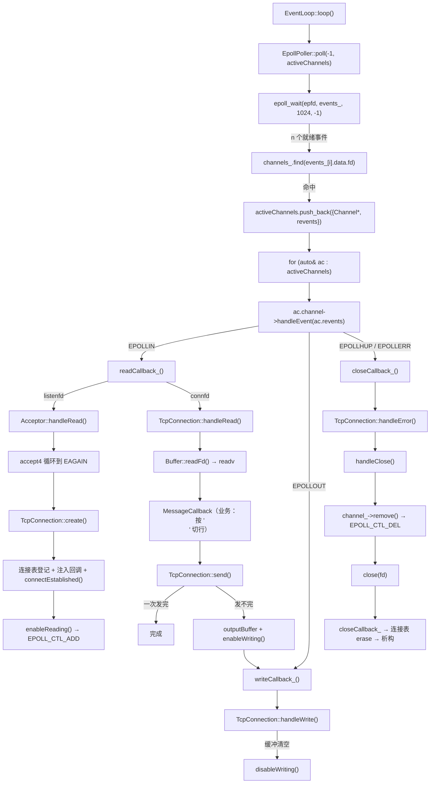
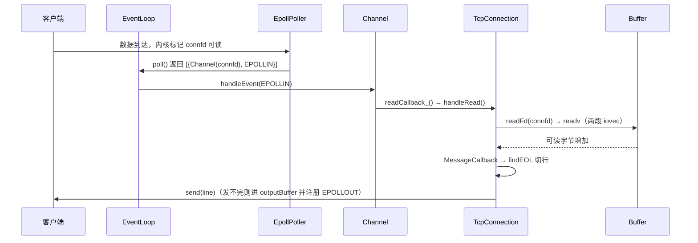
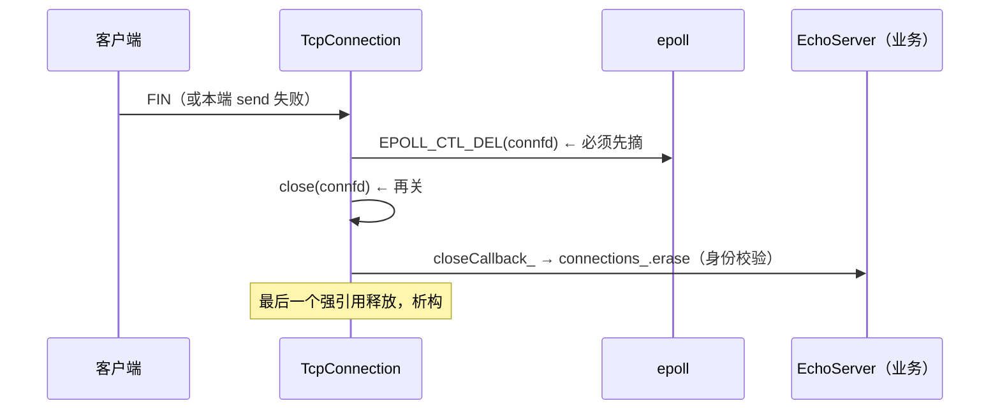

# cpp-reactor-server 架构说明

> 更新时间：Day 9（单线程 Reactor 验收）
> 当前模型：**单线程 Reactor**。Day 10 起演进为「主从 Reactor + 线程池」，本文档随之更新。

## 1. 一句话模型

一个线程、一个 `EventLoop`、一个 epoll 实例、N 条连接；**所有 fd 的所有事件，都在同一个线程里串行处理**。

## 2. 模块职责与边界

| 模块 | 负责什么 | 明确不做什么 |
| --- | --- | --- |
| `EventLoop` | 驱动 `loop()`；持有 poller 与 fd→Channel 映射；`updateChannel/removeChannel` | 不存业务、不读数据、不认识 Acceptor |
| `EpollPoller` | 封装 `epoll_create1/epoll_ctl/epoll_wait`；把就绪 fd 反查成 `Channel*` | 不持有 `Channel`、不回调业务 |
| `Channel` | 「一个 fd + 我关心的事件 + 三类回调」的绑定 | 不 close fd、不读数据 |
| `Acceptor` | 建 listenfd、循环 `accept4`、把 connfd 交给上层 | 不创建连接对象、不读写 |
| `TcpConnection` | 一条连接的生命周期、读写、关闭；持有两块 Buffer | 不认业务协议 |
| `Buffer` | 每条连接私有的字节水池（读下标/写下标/预留头部） | 不知道 fd 是什么（只有 `readFd` 碰系统调用） |
| 业务（示例） | `MessageCallback` 里按 `\n` 切行、echo | 不碰 epoll、不碰 fd 关闭 |

## 3. 一次事件的完整流转（7 步，务必背下来）

1. `EventLoop::loop()` 进入死循环，每轮先清空 `activeChannels`。
2. `EpollPoller::poll(-1, activeChannels)` → `epoll_wait(epfd, events_, 1024, -1)` **阻塞**。
3. 内核把就绪事件写进 `events_` 数组；`events_[i].data.fd` 就是当初 `epoll_ctl ADD` 时填的 fd。
4. `poll()` 用 `channels_.find(fd)` 反查 `Channel*`，把 `{Channel*, revents}` 塞进 `activeChannels`。
5. `EventLoop` 遍历 `activeChannels`，逐个 `channel->handleEvent(revents)`。
6. `Channel` 按位分派：`EPOLLHUP|EPOLLERR` → `closeCallback_`；`EPOLLIN|EPOLLPRI|EPOLLRDHUP` → `readCallback_`；`EPOLLOUT` → `writeCallback_`。
7. 回调是 lambda，按 fd 的来源分两种：**listenfd** → `Acceptor::handleRead`（accept4 循环）；**connfd** → `TcpConnection::handleRead`（`readFd` → `MessageCallback` → `send`）。

> 注意第 4 步：**反查发生在 poll() 里，不在 EventLoop 里**。这是很多人画图时画错的地方。

## 4. 事件流转图



## 5. 一次 echo 的时序（正常路径）



## 6. 关闭时序（顺序固定，不许换）



顺序理由：`close` 之后 fd 号立即可被内核复用，此时再做 `DEL` 会摘掉**新连接**的注册。

## 7. 背压（EPOLLOUT 的正确用法）

- `EPOLLOUT` **默认几乎一直就绪**（发送缓冲空就触发），所以只在“确实有数据发不出去”时才 `enableWriting()`。
- `send` 一次没发完 → 剩余字节进 `outputBuffer_` → 注册 `EPOLLOUT`。
- `handleWrite` 把缓冲发空 → **立刻** `disableWriting()`，否则 `epoll_wait` 立刻返回、空转烧 CPU。
- **业务顺序保证**：`outputBuffer_` 非空时不允许“直接 send”，新数据一律排队，防止乱序。

## 8. 今天刻意的取舍（已知限制 → 对应任务）

| 已知限制 | 为什么暂时不管 | 什么时候解决 |
| --- | --- | --- |
| 单线程，一个连接卡住全卡 | 先跑通模型，再扩 | Day 10–14 |
| 用 `\n` 当消息边界 | 人可读、`nc` 可测 | Day 17 换 4 字节长度前缀 |
| 没有超时/心跳，死连接不回收 | 需要定时器 | Day 15–16 |
| 业务在 EventLoop 线程里跑 | echo 足够快 | Day 14 丢线程池 |
| 无日志系统，只有 printf | 不影响正确性 | Day 18 / 后置 |

## 9. 如何验证这张图（strace 对齐）

```bash
strace -f -e trace=epoll_ctl,epoll_wait,accept4,readv,sendto,close \
       -o /tmp/arch.strace ./build/bin/echo_reactor
```

对照图中第 3–7 步逐条勾：

| 图上的箭头 | strace 里应出现 |
| --- | --- |
| `enableReading → EPOLL_CTL_ADD` | `epoll_ctl(4, EPOLL_CTL_ADD, 5, {events=EPOLLIN, ...})` |
| `epoll_wait 返回活跃 fd` | `epoll_wait(4, [{events=EPOLLIN, data={u32=5,...}}], 1024, -1) = 1` |
| `Acceptor::handleRead` | `accept4(3, ..., SOCK_NONBLOCK|SOCK_CLOEXEC) = 5` |
| `Buffer::readFd` | `readv(5, [{iov_len=1024}, {iov_len=65536}], 2)` |
| `echo 回写` | `sendto(5, "c01-#0001:...", 1411, MSG_NOSIGNAL, ...)` |
| `handleClose` | `epoll_ctl(4, EPOLL_CTL_DEL, 5, NULL) = 0` 然后 `close(5) = 0` |
